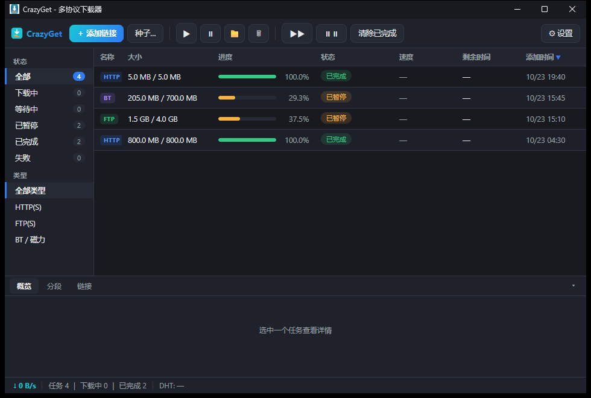

# CrazyGet - 多协议下载器（Go 版）

[](https://github.com/crazyboy945/CrazyGet)

CrazyGet 是一个简洁美观的多协议下载器，参考 qBittorrent 的布局与 IDM 的使用习惯，支持 **HTTP(S) / FTP(S) / BT / 磁力链接** 下载，内置多线程加速与断点续传。




## 功能特性

- **多协议支持**
  - HTTP(S)：Range 分段多线程下载，服务器不支持断点时自动降级单流
  - FTP(S)：多连接 + REST 偏移续传，不支持 REST 的服务器自动降级
  - BT / 磁力：DHT + Tracker，元数据本地缓存，暂停/恢复免重新拉种
- **多线程下载**：每任务 1~32 线程可调，文件按段并发抓取
- **断点续传**：分段进度实时落盘，重启程序、暂停恢复都能从断点继续
- **剪贴板监听**：复制了下载链接时自动弹出提示，一键「立即下载」（可在设置关闭）
- **qBittorrent 风格界面**
  - 工具栏：添加链接/种子、开始/暂停/删除、全部开始/暂停
  - 左侧状态过滤栏（下载中/等待中/已暂停/已完成/失败，带实时计数）+ 协议类型过滤
  - 多列任务表格：名称/大小/进度/状态/速度/剩余时间/添加时间，点击表头排序
  - 底部信息面板：概览（路径/时间/InfoHash）、分段（各线程进度可视化）、链接
  - 右键菜单、双击打开文件夹、Ctrl+V 粘贴链接、Delete 删除
- **深/浅双主题**：Material 配色，设置中一键切换

## 使用说明

1. 点击「＋ 添加链接」（快捷键 **Alt+A**，或直接 Ctrl+V 粘贴），支持每行多个链接批量添加
   - 支持 `http(s)://`、`ftp(s)://`、`magnet:?xt=...`
   - 本地 `.torrent` 文件路径也可以直接粘贴
2. 或点击「种子…」（快捷键 **Alt+T**）选择本地种子文件
3. 剪贴板监听：复制下载链接后会自动弹出「立即下载」提示（可在设置关闭）
4. 左侧过滤栏按状态/类型筛选，点击表头排序，双击行打开所在文件夹
5. 右键任务：开始/暂停/打开文件夹/复制链接/删除
6. 「⚙ 设置」里可切换深浅主题、调整线程数与 BT 限速

数据存放位置：

| 内容 | 位置 |
|------|------|
| 配置与任务记录 | `%APPDATA%\CrazyGet\` |
| 下载文件 | 默认 `下载\CrazyGet\`，可在设置中修改 |

## 技术栈

- **语言**：Go 1.27（`CGO_ENABLED=0`，纯静态编译单文件 exe）
- **GUI**：[Wails v2](https://wails.io)（WebView2 渲染，HTML/CSS 前端）
- **BT 引擎**：[anacrolix/torrent](https://github.com/anacrolix/torrent)
- **FTP 引擎**：[jlaffaye/ftp](https://github.com/jlaffaye/ftp)
- **HTTP 引擎**：标准库 `net/http`（自研分段调度器）

## 构建与自测

```bash
# 核心自测（HTTP 单线程/多线程/断点续传/降级/空文件/持久化）
CrazyGet.exe --selftest

# 构建（注意必须带 build tags）
go build -trimpath -tags desktop,production -ldflags "-s -w -H windowsgui" -o CrazyGet.exe .

# 版本资源与图标
#   resource.syso（由 versioninfo.json + assets/icon.ico 生成）会自动链接进 exe
```

工具链说明：本项目使用便携版 Go（`D:\Loomy\tools\go`）构建，模块代理 `goproxy.cn`。

## 目录结构

```
CrazyGet/
├── main.go            # Wails 入口
├── app.go             # 前端绑定层（GetTasks/AddTask/...）
├── core/              # 下载核心
│   ├── task.go        # 任务模型
│   ├── manager.go     # 调度/速度统计/持久化
│   ├── http_dl.go     # HTTP 引擎（分段+续传）
│   ├── ftp_dl.go      # FTP 引擎（多连接+REST）
│   ├── bt_dl.go       # BT/磁力引擎
│   ├── util.go        # 工具函数
│   └── selftest.go    # 核心自测
├── frontend/dist/     # 前端（index.html / style.css / main.js）
├── assets/            # 图标（png/ico）
└── versioninfo.json   # Windows 版本资源定义
```

## 版本历史

- **v0.2.4（Go 版）**：修复「添加链接/种子无反应」（前端重复声明变量导致整个脚本失效）；新增键盘快捷键 Alt+A/Alt+T；前端运行时错误会显示在状态栏；全新深色霓虹图标
- v0.2.3（Go 版）：速度显示平滑化（滑动窗口 + 指数平滑，消除间歇归零）
- v0.2.2（Go 版）：修复速度列不显示（Speed 字段未序列化）；新增剪贴板监听提示
- v0.2.1（Go 版）：界面重构为 qBittorrent 风格（状态过滤栏 + 多列表格 + 信息面板 + 右键菜单）
- v0.2.0（Go 版）：Go + Wails v2 重写，WebView2 渲染，深浅双主题，BT 元数据缓存
- v0.1.0（Python 版，位于 `D:\Codes\CrazyGet`）：Tk 界面原型，已归档
